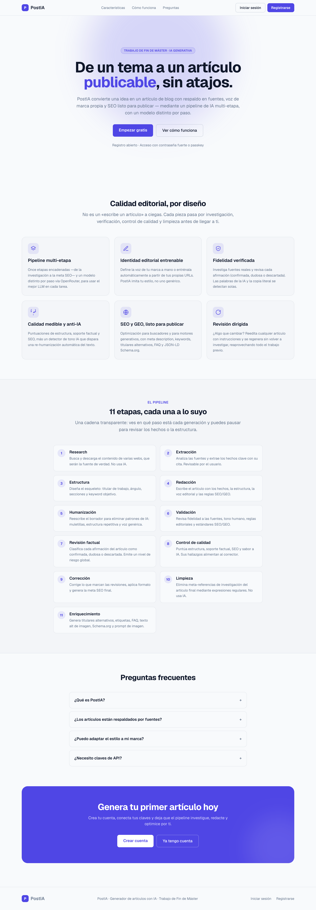
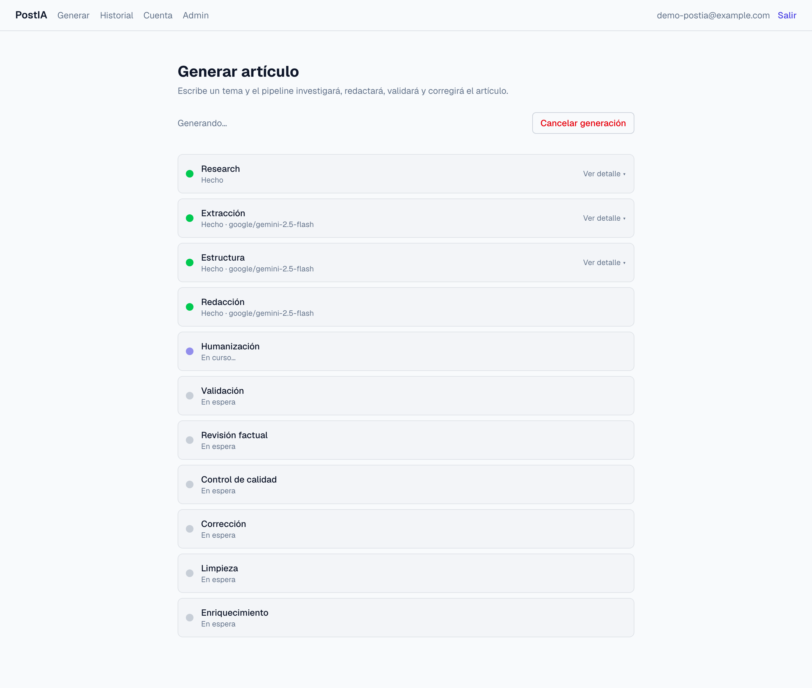
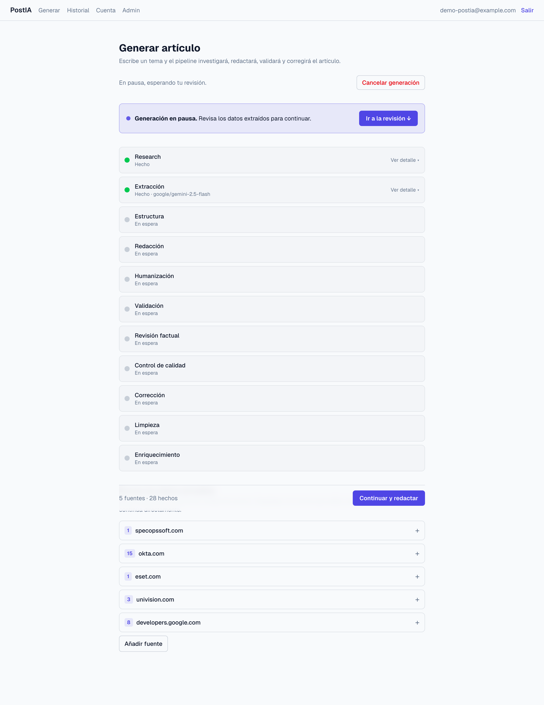
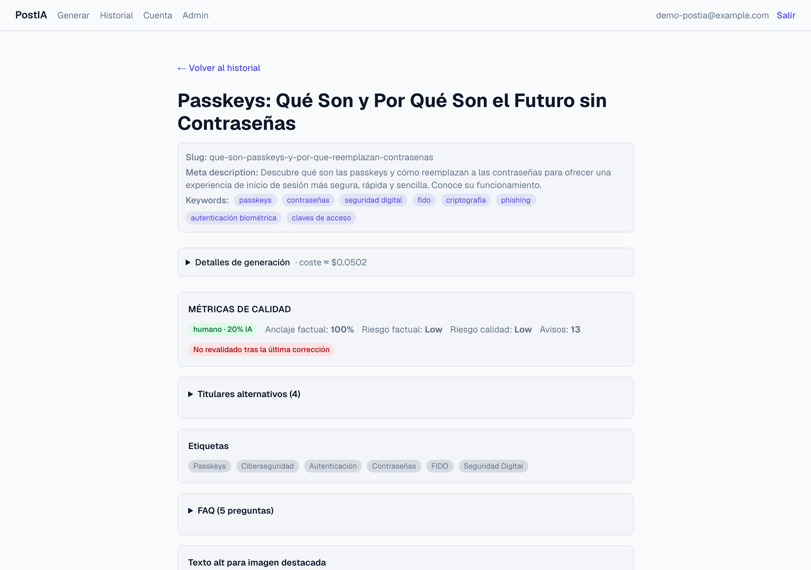
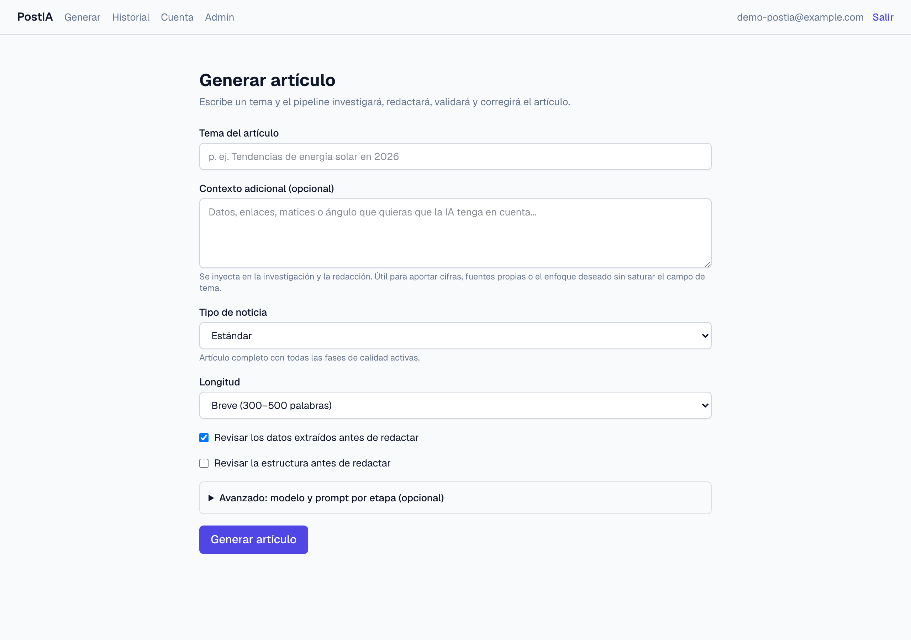
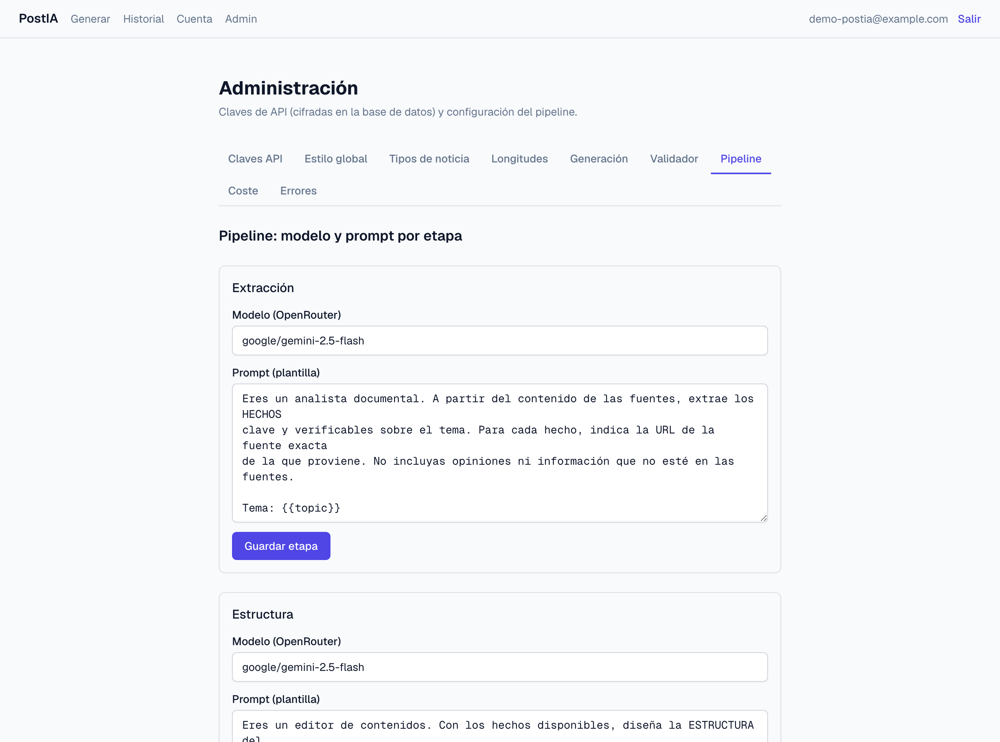
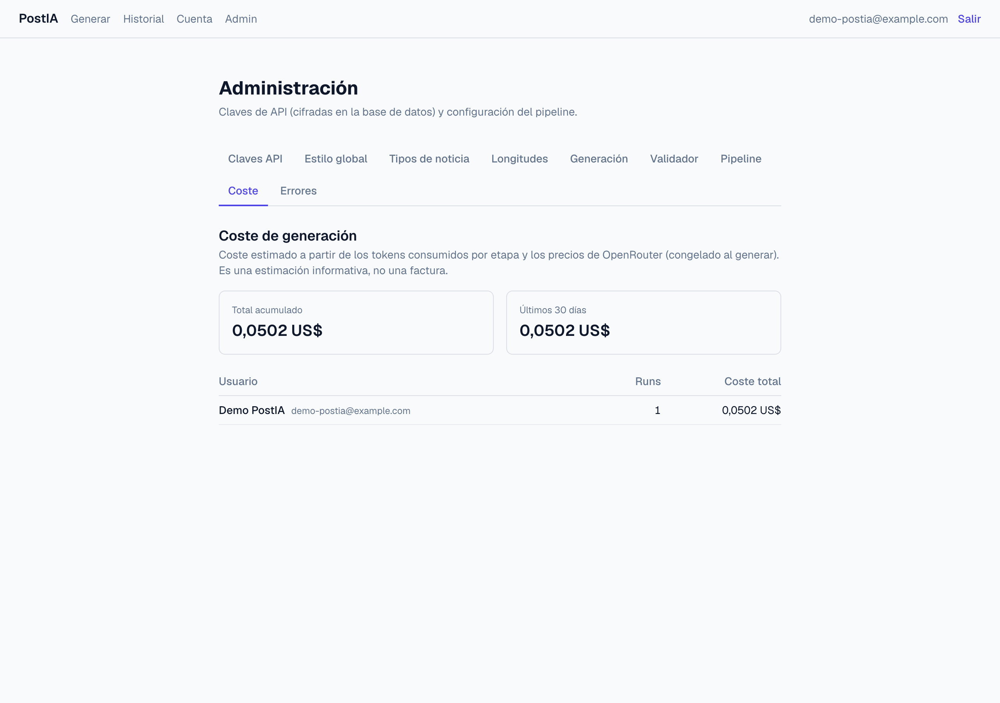
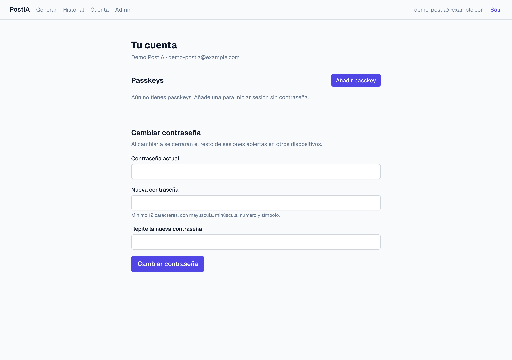

<div align="center">

# 📝 PostIA

### Genera artículos de blog publicables con un pipeline de IA multi-etapa

_De un simple **tema** a un **artículo documentado, humano y optimizado para SEO** — con fuentes reales, no inventadas._

[](https://github.com/ruvelro/TFG_MasterIA_PostIA/actions/workflows/ci.yml)
[](https://nextjs.org)
[](https://react.dev)
[](https://www.typescriptlang.org)
[](#-licencia)

> **Trabajo de Fin de Máster** · Generador de contenido editorial asistido por IA.

<br />



</div>

---

## ✨ ¿Qué es PostIA?

La mayoría de generadores de texto hacen **una sola llamada** a un modelo y te devuelven un
artículo genérico, con datos inventados y ese inconfundible "olor a IA". PostIA hace algo
distinto: orquesta un **pipeline de 12 etapas especializadas**, donde cada paso tiene una
única responsabilidad y **puede ejecutarse con el modelo más adecuado** (uno barato para
tareas mecánicas, uno potente para las que exigen criterio).

El resultado es un artículo que:

- 🔎 **Se apoya en fuentes reales** descargadas de la web (no alucinadas).
- 🧑 **Suena humano**, no a plantilla de IA.
- ✅ **Pasa por varios "jueces"** que verifican fidelidad a las fuentes, calidad y SEO.
- 🚀 **Llega listo para publicar**: con meta description, keywords, FAQ, Schema.org y más.

---

## 🌟 Características

|     | Característica                       | Detalle                                                                                            |
| --- | ------------------------------------ | -------------------------------------------------------------------------------------------------- |
| 🧩  | **Pipeline multi-etapa**             | 12 etapas encadenadas; cada una con su contrato de entrada/salida tipado.                          |
| 🎛️  | **Un modelo distinto por etapa**     | Configura qué modelo de OpenRouter usa cada paso, y su _prompt_, desde el panel de administración. |
| 🔎  | **Investigación con fuentes reales** | Busca en la web (Tavily o Google CSE) y descarga el contenido como fuente de verdad.               |
| 👀  | **Progreso en vivo**                 | Ves cada etapa ejecutarse en tiempo real mediante _streaming_.                                     |
| ✋  | **Revisión humana opcional**         | Puedes pausar para revisar y editar los **hechos** y la **estructura** antes de redactar.          |
| 🧑  | **Anti "olor a IA"**                 | Una etapa de humanización y un control de calidad que vuelve a humanizar si hace falta.            |
| 🛡️  | **Verificación factual**             | Clasifica cada afirmación (confirmada / dudosa / descartada) y emite un riesgo global.             |
| 📈  | **SEO y GEO de serie**               | Meta description, slug, keywords, FAQ, texto alt, Schema.org y prompt para la imagen.              |
| 📚  | **Historial por usuario**            | Tus artículos se guardan; los puedes releer, **revisar con instrucciones** y eliminar.             |
| 🔐  | **Autenticación robusta**            | Contraseña fuerte + **passkeys (WebAuthn)** opcionales para entrar sin contraseña.                 |
| 💸  | **Trazabilidad y coste**             | Cada ejecución registra qué modelo usó cada etapa, cuántos tokens y su coste estimado.             |
| 🧮  | **Tipos de noticia y longitud**      | Plantillas que activan/desactivan etapas y ajustan la extensión del artículo.                      |

---

## 🛠️ ¿Cómo funciona? El pipeline en 12 etapas

```
  TEMA
   │
   ▼
 ① research ──────► busca y descarga fuentes reales        (sin IA)
   │
 ② extract ───────► extrae los hechos clave con su cita    ✋ revisable
   │
 ③ blueprint ─────► diseña titular, ángulo y secciones     ✋ revisable
   │
 ④ draft ─────────► redacta el borrador (hechos + SEO/GEO)
   │
 ⑤ humanize ──────► elimina patrones y muletillas de IA
   │
   ├─►  ⑥ validate         (juez: fidelidad · tono · editorial · SEO)
   │    ⑦ factual-review   (juez: ¿cada afirmación se sostiene?)   ⟲  bucle de calidad
   │    ⑧ quality-review   (juez: estructura · SEO · "aiScore")    (re-humaniza / corrige)
   │    ⑨ fixer            (corrige y genera la meta SEO)
   │
 ⑩ scrub ─────────► limpia meta-referencias de investigación      (sin IA)
   │
 ⑪ enrich ────────► titulares alt, tags, FAQ, alt, Schema.org
   │
 ⑫ feature-image ─► genera la imagen destacada (modelo de imagen)
   │
   ▼
 ARTÍCULO PUBLICABLE  📰
```

> Las etapas **humanize**, **factual-review**, **quality-review** y **feature-image** son
> **opcionales** según el _tipo de noticia_. La explicación completa de cada etapa está en
> [`docs/pipeline.md`](docs/pipeline.md).

<div align="center">
  
  <br />
  <sub><i>El pipeline ejecutándose en directo: cada etapa muestra su estado y el modelo que usa.</i></sub>
</div>

---

## 🚀 Cómo usar PostIA (guía rápida)

### 1. Crea tu cuenta

Entra en `/register` y date de alta con tu email y una contraseña que cumpla la política:

> 🔒 Mínimo **12 caracteres**, con **mayúscula, minúscula, número y símbolo** (se rechazan
> las contraseñas más comunes). Ejemplo válido: `Tfg-PostIA-2026!`

> 👑 El **primer usuario** que se registre se convierte automáticamente en **administrador**.

### 2. Configura las claves (solo administrador)

Ve a **`/admin`** y añade:

- 🔑 Tu **clave de OpenRouter** — es la que da acceso a todos los modelos de IA.
- 🔎 La clave de un **buscador**: Tavily o Google Custom Search.

> Las claves se guardan **cifradas** en la base de datos y nunca se devuelven al navegador.
> Sin ellas, la generación real no funciona (pero el resto de la app sí).

Desde el panel de administración también puedes ajustar, de forma opcional:

- 🎛️ El **modelo y el prompt de cada etapa** del pipeline.
- 📐 **Presets de longitud** y **tipos de noticia** (qué etapas se activan).
- 🎨 La **voz editorial** (analizando un texto de ejemplo).
- 📊 Paneles de **costes** y **registro de errores**.

### 3. Genera un artículo

Ve a **`/generate`**, escribe el **tema** y lanza la generación. Verás cada etapa avanzar en
directo. Si activas la revisión humana, la app **se pausará** para que puedas:

- ✏️ Revisar y editar los **hechos** extraídos antes de redactar.
- 🧱 Ajustar la **estructura** propuesta (titular, secciones, keyword).

<div align="center">
  
  <br />
  <sub><i>Pausa de revisión: los hechos agrupados por fuente, listos para editar antes de redactar.</i></sub>
</div>

### 4. Lee, revisa y gestiona

Cuando termine, el artículo se guarda en tu **historial** (`/articles`). Allí puedes:

- 📖 Releerlo con todo su contenido y metadatos SEO.
- 🔁 **Revisarlo con instrucciones** ("hazlo más técnico", "acorta la introducción"…): se
  regenera reutilizando las fuentes, sin volver a investigar.
- 🗑️ Eliminarlo.

<div align="center">
  
  <br />
  <sub><i>El artículo final: meta SEO, keywords, métricas de calidad (anclaje factual, riesgo, % humano), FAQ y más.</i></sub>
</div>

### 5. (Opcional) Protege tu cuenta con una passkey

En **`/account`** puedes registrar una **passkey (WebAuthn)** para iniciar sesión sin
contraseña, resistente a phishing.

---

## 💻 Instalación y ejecución

Requisitos: **Node.js 24+** y npm (la versión exacta está en [`.nvmrc`](.nvmrc)).

### Opción A — Desarrollo local

```bash
# 1. Instalar dependencias
npm install

# 2. Configurar el entorno
cp .env.example .env
#    Genera AUTH_SECRET y ENCRYPTION_KEY (cada uno):  openssl rand -base64 32
#    Las claves de OpenRouter y del buscador NO van aquí: se configuran luego desde /admin.

# 3. Preparar la base de datos (crea el SQLite y aplica las migraciones)
npm run db:migrate

# 4. Arrancar
npm run dev
```

La app queda en **http://localhost:3000**.

### Opción B — Docker (recomendada para desplegar)

Las migraciones se aplican solas al arrancar el contenedor:

```bash
cp .env.example .env          # rellena AUTH_SECRET, ENCRYPTION_KEY y APP_URL
docker compose up -d --build  # app en http://TU_IP:${APP_PORT}  (por defecto 38291)
```

Imagen multi-stage, usuario no-root y secretos solo en `.env` (nunca en la imagen). Guía
completa en [`docs/despliegue.md`](docs/despliegue.md).

---

## 🧱 Stack tecnológico

| Capa          | Tecnología                                                 |
| ------------- | ---------------------------------------------------------- |
| Framework     | Next.js 16 (App Router) + React 19                         |
| Lenguaje      | TypeScript (modo estricto)                                 |
| Estilos       | Tailwind CSS v4                                            |
| Persistencia  | Prisma 7 + SQLite                                          |
| Autenticación | Better Auth (email + contraseña, passkeys/WebAuthn)        |
| IA            | Vercel AI SDK + OpenRouter (modelo configurable por etapa) |
| Búsqueda      | Tavily / Google Custom Search (abstracción intercambiable) |
| Validación    | Zod v4                                                     |
| Tests         | Vitest (unit/integration) + Playwright (e2e)               |
| Calidad       | ESLint + Prettier + Husky + lint-staged + CI               |

El porqué de cada elección está en [`docs/stack.md`](docs/stack.md).

---

## 📸 Galería

<table>
  <tr>
    <td width="50%" align="center">
      <br />
      <sub><b>Generar</b> · tema, tipo de noticia, longitud y opciones de revisión</sub>
    </td>
    <td width="50%" align="center">
      <br />
      <sub><b>Admin · Pipeline</b> · modelo y prompt configurables por etapa</sub>
    </td>
  </tr>
  <tr>
    <td width="50%" align="center">
      <br />
      <sub><b>Admin · Coste</b> · gasto por etapa y por ejecución</sub>
    </td>
    <td width="50%" align="center">
      <br />
      <sub><b>Cuenta</b> · passkeys (WebAuthn) y cambio de contraseña</sub>
    </td>
  </tr>
</table>

---

## 📚 Documentación

Toda la documentación detallada vive en [`docs/`](docs/):

| Documento                               | Contenido                                           |
| --------------------------------------- | --------------------------------------------------- |
| [arquitectura.md](docs/arquitectura.md) | Visión general, capas y flujo de datos.             |
| [pipeline.md](docs/pipeline.md)         | Las 12 etapas, contratos y modelo por etapa.        |
| [stack.md](docs/stack.md)               | Stack tecnológico y justificación de cada elección. |
| [seguridad.md](docs/seguridad.md)       | Modelo de amenazas y controles de seguridad.        |
| [modelo-datos.md](docs/modelo-datos.md) | Entidades de la base de datos y relaciones.         |
| [despliegue.md](docs/despliegue.md)     | Despliegue con Docker en un VPS.                    |
| [contribucion.md](docs/contribucion.md) | Flujo de Git, ramas, commits y PRs.                 |
| [decisiones/](docs/decisiones/)         | Registro de decisiones de arquitectura (ADRs).      |

> Para las normas que sigue el código (convenciones, seguridad por diseño, idioma), ver
> [`AGENTS.md`](AGENTS.md).

---

## ⚙️ Scripts

| Comando                 | Descripción                            |
| ----------------------- | -------------------------------------- |
| `npm run dev`           | Servidor de desarrollo                 |
| `npm run build`         | Build de producción                    |
| `npm run typecheck`     | Comprobación de tipos (`tsc --noEmit`) |
| `npm run lint`          | Linter (ESLint)                        |
| `npm run format`        | Formateo con Prettier                  |
| `npm run test`          | Tests unit/integration (Vitest)        |
| `npm run test:coverage` | Tests con cobertura                    |
| `npm run test:e2e`      | Tests end-to-end (Playwright)          |
| `npm run db:migrate`    | Crea/actualiza la BD SQLite local      |
| `npm run db:studio`     | Explorador visual de la base de datos  |

> Antes de abrir un PR: `npm run lint && npm run typecheck && npm run test` en verde.

---

## 📄 Licencia

Proyecto académico (Trabajo de Fin de Máster). **Uso educativo.**
