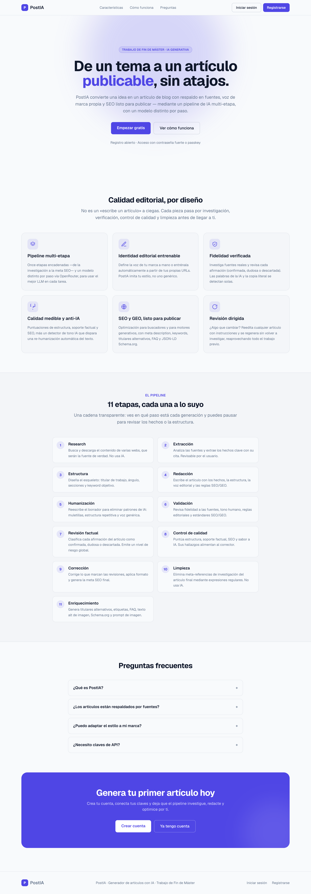

<div align="center">

# PostIA — Generación de artículos de blog mediante un pipeline de IA multi-etapa

### Memoria del Trabajo de Fin de Máster

<br />

**Autor:** _[Nombre y apellidos del autor]_
**Tutor/a:** _[Nombre del tutor/a]_
**Titulación:** _[Máster Universitario en …]_
**Universidad:** _[Universidad]_
**Curso académico:** 2025 / 2026
**Fecha de entrega:** _[día de mes de 2026]_

<br />



</div>

> **Nota para el autor.** Los campos entre _[corchetes]_ de la portada y los datos
> institucionales deben completarse con la información real de tu centro. El resto del
> documento está redactado a partir del código y la documentación reales del proyecto
> (repositorio, ADRs y resultados de ejecución). Las referencias bibliográficas del
> capítulo 3 y de la bibliografía son fuentes reales y reconocidas, pero conviene
> verificarlas y darles el formato de cita exigido por tu universidad (APA, IEEE, etc.).

---

## Resumen

PostIA es una aplicación web que transforma un **tema** en un **artículo de blog
publicable** mediante un **pipeline de inteligencia artificial de once etapas**, en el que
cada etapa cumple una única responsabilidad y puede ejecutarse con un modelo de lenguaje
distinto a través de la pasarela **OpenRouter**. Frente al enfoque habitual de «una sola
llamada a un modelo», que produce texto genérico y propenso a inventar datos, PostIA parte
de **fuentes reales descargadas de la web**, separa la extracción de hechos del diseño
estructural, permite la **revisión humana** de los datos antes de redactar, **humaniza** el
borrador para eliminar el característico «sabor a IA», somete el resultado a varios **jueces
especializados** (fidelidad factual, calidad y SEO) dentro de un **bucle de corrección**, y
finalmente **enriquece** el artículo con metadatos SEO/GEO (meta description, FAQ,
Schema.org, titulares alternativos, etc.).

El proyecto se ha desarrollado priorizando las **buenas prácticas de ingeniería del
software** —que constituyen el criterio principal de evaluación—: arquitectura por capas con
dominio desacoplado de la interfaz, tipado estricto, validación exhaustiva de entradas y
salidas, seguridad por diseño (autenticación robusta con contraseñas fuertes y passkeys,
cifrado de secretos en reposo, autorización por roles), una suite de pruebas automatizadas
(unitarias, de integración y de extremo a extremo) e integración continua.

**Palabras clave:** generación de lenguaje natural, grandes modelos de lenguaje (LLM),
pipeline multi-etapa, RAG, OpenRouter, Next.js, SEO/GEO, buenas prácticas de software,
seguridad por diseño.

## Abstract

PostIA is a web application that turns a **topic** into a **publish-ready blog article**
through an **eleven-stage AI pipeline**, where every stage has a single responsibility and
may run on a different language model via the **OpenRouter** gateway. Unlike the usual
«single model call» approach —which yields generic, hallucination-prone text— PostIA starts
from **real web sources**, separates fact extraction from structural design, allows **human
review** of the facts before drafting, **humanises** the draft to remove the typical «AI
flavour», runs the result through several **specialised judges** (factual faithfulness,
quality and SEO) inside a **correction loop**, and finally **enriches** the article with
SEO/GEO metadata (meta description, FAQ, Schema.org, alternative headlines, etc.).

The project was built with a strong focus on **software engineering best practices** —the
main grading criterion—: a layered architecture with a UI-decoupled domain, strict typing,
thorough input/output validation, security by design (robust authentication with strong
passwords and passkeys, encryption of secrets at rest, role-based authorization), an
automated test suite (unit, integration and end-to-end) and continuous integration.

**Keywords:** natural language generation, large language models (LLM), multi-stage
pipeline, RAG, OpenRouter, Next.js, SEO/GEO, software best practices, security by design.

---

## Índice

1. [Introducción](#1-introducción)
2. [Objetivos](#2-objetivos)
3. [Estado del arte](#3-estado-del-arte)
4. [Metodología y planificación](#4-metodología-y-planificación)
5. [Análisis de requisitos](#5-análisis-de-requisitos)
6. [Diseño y arquitectura](#6-diseño-y-arquitectura)
7. [Implementación](#7-implementación)
8. [Pruebas y aseguramiento de la calidad](#8-pruebas-y-aseguramiento-de-la-calidad)
9. [Resultados](#9-resultados)
10. [Conclusiones y líneas futuras](#10-conclusiones-y-líneas-futuras)
11. [Bibliografía](#11-bibliografía)
12. [Anexos](#12-anexos)

---

## 1. Introducción

### 1.1. Contexto

La irrupción de los grandes modelos de lenguaje (LLM) ha popularizado la generación
automática de contenido textual. Hoy es trivial pedir a un modelo «escríbeme un artículo
sobre X» y obtener varios párrafos en segundos. Sin embargo, ese contenido generado de un
solo paso adolece de problemas bien conocidos que lo hacen poco apto para su publicación
profesional:

- **Alucinaciones.** El modelo afirma datos, cifras o citas que no ha verificado y que con
  frecuencia son falsos, porque genera el texto más probable, no el más veraz.
- **«Sabor a IA».** Estructura repetitiva, muletillas («en el vertiginoso mundo de…», «en
  resumen», «es importante destacar que…»), conclusiones genéricas y una voz uniforme que
  los lectores —y cada vez más los motores de búsqueda— reconocen y penalizan.
- **Falta de optimización.** El texto plano no incluye los metadatos que un artículo
  publicable necesita: una meta description trabajada, palabras clave, datos estructurados
  (Schema.org), preguntas frecuentes, etc.

### 1.2. Motivación y planteamiento del problema

La hipótesis de este trabajo es que **descomponer la generación en etapas especializadas**,
cada una con una responsabilidad acotada y, opcionalmente, con un modelo distinto, produce
artículos sustancialmente mejores que una única llamada monolítica. Esta descomposición
permite, además:

- **Anclar el contenido en fuentes reales** (un patrón cercano a _Retrieval-Augmented
  Generation_, RAG): primero se investiga y se descarga el contenido de varias páginas web,
  y solo después se redacta a partir de esos hechos verificables.
- **Insertar control humano** en los puntos críticos del flujo (validar los hechos
  extraídos, ajustar la estructura propuesta) sin renunciar a la automatización del resto.
- **Especializar la validación**: en lugar de un juez único que mezcla criterios, varios
  jueces evalúan por separado la fidelidad factual, la calidad editorial y el SEO, de modo
  que sus informes son accionables y medibles.
- **Optimizar el coste**: las tareas mecánicas pueden ejecutarse con modelos baratos y solo
  las que exigen criterio con modelos más potentes, decisión que se toma por configuración y
  no por código.

### 1.3. Aportación del trabajo

PostIA materializa esa hipótesis en una aplicación web completa y funcional, pero el valor
del trabajo como TFM no reside únicamente en que «funcione», sino en **cómo está
construido**. El criterio de evaluación declarado es la calidad de la ingeniería: por ello
el proyecto cuida de forma deliberada la arquitectura, la seguridad, el tipado, las pruebas
automatizadas, el flujo de trabajo con Git y la documentación. Esta memoria describe tanto el
**producto** (qué hace y para quién) como el **proceso** y las **decisiones de diseño** que
lo sustentan, muchas de ellas registradas como _Architecture Decision Records_ (ADR).

### 1.4. Estructura de la memoria

El capítulo 2 fija los objetivos. El capítulo 3 sitúa el trabajo en el estado del arte de la
generación de contenido con IA. El capítulo 4 describe la metodología y la planificación. El
capítulo 5 recoge el análisis de requisitos. Los capítulos 6 y 7 detallan el diseño y la
implementación. El capítulo 8 expone la estrategia de pruebas y la calidad. El capítulo 9
presenta los resultados, el 10 las conclusiones y líneas futuras, y se cierra con
bibliografía y anexos.

---

## 2. Objetivos

### 2.1. Objetivo general

Diseñar y desarrollar una aplicación web que genere artículos de blog **publicables** a
partir de un tema, mediante un pipeline de IA multi-etapa con fuentes reales, aplicando y
demostrando **buenas prácticas de ingeniería del software**.

### 2.2. Objetivos específicos

| #   | Objetivo                                                                                                                                       |
| --- | ---------------------------------------------------------------------------------------------------------------------------------------------- |
| O1  | Construir un pipeline de generación por etapas, con una responsabilidad única por etapa y contratos de entrada/salida tipados y validados.     |
| O2  | Anclar el contenido en **fuentes reales** descargadas de la web, no en conocimiento alucinado por el modelo.                                   |
| O3  | Permitir **configurar el modelo y el prompt de cada etapa** de forma independiente, sin tocar código.                                          |
| O4  | Incorporar **revisión humana opcional** de los hechos y de la estructura antes de la redacción.                                                |
| O5  | Reducir el «sabor a IA» mediante una etapa de humanización gobernada por una métrica objetiva, y validar la calidad con jueces especializados. |
| O6  | Producir un artículo **enriquecido para SEO/GEO** (meta description, keywords, FAQ, Schema.org, etc.).                                         |
| O7  | Aplicar **seguridad por diseño**: autenticación robusta, autorización por roles, cifrado de secretos y validación de toda entrada.             |
| O8  | Garantizar la calidad con **pruebas automatizadas** (unitarias, integración y e2e) e **integración continua**.                                 |
| O9  | Mantener una **documentación** rigurosa (arquitectura, modelo de datos, seguridad, decisiones) y un flujo de trabajo **Git** profesional.      |
| O10 | Asegurar la **reproducibilidad** y el despliegue sencillo mediante contenedores (Docker).                                                      |

### 2.3. Alcance y limitaciones

El proyecto se centra en el flujo completo «tema → artículo publicable», con generación
multi-idioma, exportación Markdown/HTML, publicación opcional en WordPress e imagen destacada
cuando el tipo de noticia lo activa. Quedan **fuera del alcance** el escalado horizontal en
arquitecturas _serverless_ con timeouts cortos, una cola durable para lotes largos y la gestión
multi-tenant de marcas o portales. La persistencia emplea SQLite, suficiente para el alcance
académico y migrable a PostgreSQL sin cambios de esquema.

---

## 3. Estado del arte

### 3.1. Grandes modelos de lenguaje y generación de texto

Los LLM basados en la arquitectura _Transformer_ (Vaswani et al., 2017) y popularizados por
la familia GPT (Brown et al., 2020) generan texto prediciendo el siguiente token más
probable. Esta naturaleza probabilística explica su principal debilidad para el contenido
informativo: la **alucinación**, es decir, la generación de afirmaciones plausibles pero
falsas (Ji et al., 2023). En tareas donde la veracidad importa —como un artículo
periodístico o divulgativo— este problema es crítico.

### 3.2. Recuperación aumentada (RAG) y anclaje en fuentes

Una técnica consolidada para mitigar la alucinación es la **generación aumentada por
recuperación** (_Retrieval-Augmented Generation_, RAG; Lewis et al., 2020): antes de generar,
el sistema recupera documentos relevantes de una fuente externa y los aporta al modelo como
contexto, de modo que la respuesta se ancla en información real y citable. PostIA aplica una
variante de esta idea orientada a la web: su etapa de _research_ busca y **descarga el
contenido** de varias páginas reales, que se convierten en la «fuente de verdad» de la que se
extraen los hechos. A diferencia de un RAG clásico sobre una base vectorial, aquí la
recuperación es de páginas web en vivo a través de APIs de búsqueda.

### 3.3. El problema del «contenido IA» y su detección

La proliferación de texto generado ha dado lugar al fenómeno conocido coloquialmente como
_AI slop_: contenido masivo, genérico y de bajo valor. Tanto los lectores como los buscadores
reaccionan ante él; Google, por ejemplo, ha endurecido sus directrices hacia el contenido
«útil» y con experiencia demostrable (marco **E-E-A-T**: _Experience, Expertise,
Authoritativeness, Trustworthiness_). Existen detectores automáticos de texto generado, pero
su fiabilidad es discutida. PostIA aborda el problema desde la **producción**, no desde la
detección: una etapa de _humanize_ reescribe el borrador para eliminar patrones de IA, y un
juez de calidad emite una puntuación objetiva (`aiScore`) que **gobierna** cuántas veces se
re-humaniza el texto.

### 3.4. SEO y la emergencia del GEO

La **optimización para motores de búsqueda** (SEO) es una disciplina madura. Más reciente es
la **optimización para motores generativos** (_Generative Engine Optimization_, GEO; Aggarwal
et al., 2024), que adapta el contenido para que sea citado por sistemas de respuesta basados
en IA (resúmenes generativos, asistentes conversacionales). Datos estructurados (Schema.org),
secciones de preguntas frecuentes y una redacción clara y extractable son palancas tanto de
SEO como de GEO. PostIA genera estos artefactos de forma automática en su etapa de
enriquecimiento.

### 3.5. Herramientas existentes y posicionamiento

En el mercado existen asistentes de redacción con IA (Jasper, Copy.ai, Writesonic, entre
otros) que ofrecen plantillas y generación asistida. Su enfoque suele ser una o pocas
llamadas a un modelo con _prompts_ elaborados, orientado a productividad de marketing. El
**diferencial de PostIA** como trabajo académico es: (i) un pipeline **transparente y
trazable** de múltiples etapas con modelo configurable por paso; (ii) el **anclaje
obligatorio en fuentes reales** descargadas; (iii) la **revisión humana** integrada en el
flujo; (iv) la **separación de la validación en jueces especializados** con un bucle de
corrección medible; y (v) un fuerte énfasis en **buenas prácticas verificables** (seguridad,
tests, CI), que es precisamente el objeto de evaluación.

---

## 4. Metodología y planificación

### 4.1. Metodología de desarrollo

Se ha seguido un desarrollo **iterativo e incremental**, organizado en **fases** que añaden
valor de forma acumulada y dejan el proyecto siempre en un estado funcional y verificable.
Cada incremento se acompaña de sus pruebas y de la actualización de la documentación
correspondiente, de modo que la calidad no se pospone a una fase final.

### 4.2. Fases del proyecto

| Fase | Hito                                                                                       |
| ---- | ------------------------------------------------------------------------------------------ |
| 1    | Cimientos: stack, arquitectura por capas, validación de entorno, CI inicial.               |
| 2    | Autenticación y seguridad: registro, contraseñas fuertes, passkeys, roles.                 |
| 3    | Configuración: claves de API cifradas, ajustes y configuración por etapa (panel de admin). |
| 4    | Pipeline de generación: orquestador, etapas, streaming de progreso y revisión humana.      |
| 5    | Evolución del pipeline a 12 etapas (humanización, jueces, scrub, enrich e imagen).         |
| 6    | Observabilidad (coste por etapa, registro de errores), endurecimiento y despliegue Docker. |

La evolución del pipeline (de 5 a 6 y de 6 a 12 etapas) está documentada en los ADR 0004 y
0006, y refleja un aprendizaje real del uso del sistema con casos concretos.

### 4.3. Control de versiones y flujo de trabajo

El proyecto usa **Git** con un flujo de ramas tipo _git-flow_ simplificado:

```
main ──────●────────────────────────●───────►   (estable, solo releases)
            \                       /
develop ─────●────●────●────●──────●─────────►   (integración)
              \        \
               feature/x feature/y               (trabajo del día a día)
```

- `main`: siempre desplegable; solo recibe _merges_ desde `develop` mediante PR de release.
- `develop`: rama de integración; cada unidad de trabajo entra por **Pull Request**.
- Ramas `feature/*`, `fix/*`, `chore/*`, `docs/*` para el día a día.
- **Conventional Commits** (`feat:`, `fix:`, `docs:`, `test:`, `refactor:`, `chore:`).
- **Hooks de Git** (Husky): `pre-commit` ejecuta _lint-staged_ (formato y _lint_ del código
  preparado) y `pre-push` ejecuta _typecheck_ y tests, evitando subir código roto.

A lo largo del desarrollo se acumularon **98 commits** entre el 20 y el 29 de junio de 2026,
con integración continua en cada Pull Request.

### 4.4. Herramientas

Editor con asistencia de IA, Git y GitHub (repositorio, Pull Requests y Actions para CI),
Docker para empaquetado y despliegue, y el ecosistema de Node.js/TypeScript para construcción
y pruebas. La gestión de decisiones de arquitectura se documenta con **ADRs** versionados en
el propio repositorio.

---

## 5. Análisis de requisitos

### 5.1. Actores

- **Usuario registrado.** Genera artículos, imágenes y lotes, revisa los hechos y la estructura,
  consulta su historial y exporta o publica piezas. Gestiona su cuenta (contraseña, passkeys y
  claves de API personales).
- **Administrador.** Primer usuario registrado; además de lo anterior, configura las claves
  de API, el proveedor de búsqueda, el modelo y prompt de cada etapa, los tipos de noticia,
  los presets de longitud, los estilos de imagen, la voz editorial, y consulta los paneles de
  coste y errores.

### 5.2. Requisitos funcionales

| ID   | Requisito                                                                                                        |
| ---- | ---------------------------------------------------------------------------------------------------------------- |
| RF1  | Registro abierto de usuarios con política de contraseñas fuertes; el primer usuario se promueve a admin.         |
| RF2  | Inicio de sesión con email/contraseña y, opcionalmente, con **passkey** (WebAuthn).                              |
| RF3  | Generar un artículo a partir de un tema (y contexto opcional), eligiendo tipo, longitud e idioma.                |
| RF4  | Investigar y **descargar** el contenido de varias fuentes web reales como base del artículo.                     |
| RF5  | Pausar la generación para que el usuario **revise/edite los hechos** extraídos antes de redactar.                |
| RF6  | Pausar la generación para que el usuario **revise/edite la estructura** (titular, secciones, keyword).           |
| RF7  | Mostrar el **progreso en vivo** de cada etapa, con su estado y el modelo empleado.                               |
| RF8  | Humanizar el borrador y validar el resultado con jueces (fidelidad, calidad, SEO) en un **bucle de corrección**. |
| RF9  | Enriquecer el artículo con metadatos SEO/GEO (meta description, keywords, FAQ, Schema.org, etc.).                |
| RF10 | Guardar los artículos por usuario y permitir **releerlos, revisarlos con instrucciones y eliminarlos**.          |
| RF11 | Configurar (admin) modelo y prompt por etapa, tipos de noticia, presets de longitud y voz editorial.             |
| RF12 | Gestionar (admin) las claves de API de forma **cifrada** y elegir el proveedor de búsqueda.                      |
| RF13 | Ofrecer (admin) observabilidad: **coste estimado por etapa/ejecución** y **registro de errores**.                |
| RF14 | Generar imágenes destacadas integradas o imágenes sueltas reutilizables desde una galería.                       |
| RF15 | Exportar Markdown/HTML, publicar en WordPress y exponer una API autenticada con claves revocables por usuario.   |
| RF16 | Crear lotes de temas con presupuesto y seguimiento de progreso.                                                  |

### 5.3. Requisitos no funcionales

| ID   | Requisito                                                                                                              |
| ---- | ---------------------------------------------------------------------------------------------------------------------- |
| RNF1 | **Seguridad por diseño**: validar toda entrada (Zod), secretos solo en servidor, autorización revalidada por petición. |
| RNF2 | **Tipado estricto** (TypeScript) sin `any`; contratos compartidos por tipos y esquemas.                                |
| RNF3 | **Testabilidad**: dominio desacoplado de la UI, con inyección de dependencias para probar sin red ni claves.           |
| RNF4 | **Mantenibilidad**: archivos pequeños y centrados (una responsabilidad), comentarios que explican el _porqué_.         |
| RNF5 | **Reproducibilidad**: ejecución local trivial y despliegue con Docker; migraciones automáticas.                        |
| RNF6 | **Observabilidad**: trazabilidad de cada etapa (modelo, tokens, duración, coste) y registro de errores.                |
| RNF7 | **Usabilidad**: progreso en vivo, mensajes claros y revisión humana accesible.                                         |
| RNF8 | **Privacidad/robustez de costes**: límites de petición (_rate limiting_) y coste por generación visible.               |

### 5.4. Casos de uso principales

- **CU1 – Generar artículo con revisión de hechos.** El usuario introduce un tema; el sistema
  investiga y extrae hechos; se pausa para que el usuario los valide; tras confirmar, el
  sistema redacta, humaniza, valida en bucle, limpia y enriquece, y guarda el artículo.
- **CU2 – Configurar el pipeline (admin).** El administrador ajusta el modelo y el prompt de
  una o varias etapas; los cambios se aplican a las siguientes generaciones sin desplegar.
- **CU3 – Revisar un artículo existente.** El usuario abre un artículo del historial y solicita
  una revisión con instrucciones; el sistema regenera reutilizando las fuentes, sin volver a
  investigar.
- **CU4 – Registrar una passkey.** El usuario añade una passkey desde su cuenta para iniciar
  sesión sin contraseña.

---

## 6. Diseño y arquitectura

### 6.1. Visión general

PostIA es una aplicación **full-stack monolítica** sobre **Next.js (App Router)**: el mismo
proyecto sirve la interfaz (React Server/Client Components) y el backend (Route Handlers y
Server Actions). Esta elección reduce la complejidad operativa —un solo despliegue, un solo
lenguaje— sin renunciar a una separación de responsabilidades clara por capas.

### 6.2. Arquitectura por capas

```
┌──────────────────────────────────────────────────────────────┐
│  app/  (UI + rutas)                                           │
│   · Páginas y layouts (React)                                 │
│   · Route Handlers (api/) y Server Actions                    │
└───────────────┬──────────────────────────────────────────────┘
                │ usa
┌───────────────▼──────────────────────────────────────────────┐
│  lib/  (dominio, sin dependencia de React)                    │
│   · pipeline/      orquestador + etapas                       │
│   · ai/            cliente OpenRouter + modelo por etapa       │
│   · search/        proveedores de búsqueda intercambiables     │
│   · auth/          Better Auth: sesión y autorización (roles)  │
│   · crypto/        cifrado de secretos en reposo (AES-256-GCM) │
│   · settings/      secretos, ajustes y config por etapa        │
│   · articles/      repositorio de artículos (por usuario)      │
│   · observability/ estadísticas de coste y registro de errores │
│   · http/          streaming NDJSON y rate limiting            │
│   · db/            cliente Prisma                              │
│   · config/        validación de entorno                       │
│   · validation/    esquemas Zod compartidos                    │
└───────────────┬──────────────────────────────────────────────┘
                │ persiste en
┌───────────────▼──────────────────────────────────────────────┐
│  Prisma + SQLite                                              │
└──────────────────────────────────────────────────────────────┘
```

El **principio clave** es que `lib/` no conoce React ni Next: es lógica de dominio testeable
de forma aislada (con Vitest), lo que mantiene los componentes finos y la lógica reutilizable.
Esta decisión (ADR 0001) sostiene la testabilidad (RNF3) y la mantenibilidad (RNF4).

### 6.3. Puntos de variación resueltos con interfaces

Dos ejes de variación se resuelven con **interfaces**, no con condicionales dispersos:

- **Modelo por etapa** (`lib/ai`): un _resolver_ mapea cada etapa a `{model, prompt}`. Cambiar
  el modelo de una etapa es cambiar configuración, no código.
- **Proveedor de búsqueda** (`lib/search`): la interfaz `SearchProvider` permite alternar entre
  Tavily y Google Custom Search sin tocar la etapa de _research_.

### 6.4. El pipeline de generación

El núcleo del sistema. Convierte un tema en un artículo mediante **doce etapas** encadenadas,
cada una con una responsabilidad única y un contrato tipado. El catálogo único y ordenado vive
en `src/lib/pipeline/stages.ts` (`STAGE_IDS`), del que beben tanto la UI como el orquestador,
de modo que añadir o reordenar una etapa es un cambio en un solo sitio.

```
research → extract → [revisión humana opcional]
        → blueprint → [revisión humana opcional]
        → draft → humanize
        → ( validate + factual-review + quality-review  ⟲  humanize / fixer )
        → scrub → enrich → Article
```

| #   | Etapa              | ¿IA?          | Responsabilidad                                                                          |
| --- | ------------------ | ------------- | ---------------------------------------------------------------------------------------- |
| 1   | **research**       | No (búsqueda) | Busca N fuentes y **descarga su contenido** (fuente de verdad).                          |
| 2   | **extract**        | Sí            | Extrae hechos con su cita `{claim, source}`. **Revisable** por el usuario.               |
| 3   | **blueprint**      | Sí            | Diseña titular, ángulo, secciones y keyword. **Revisable** por el usuario.               |
| 4   | **draft**          | Sí            | Redacta el borrador con hechos + estructura + voz editorial + reglas SEO/GEO.            |
| 5   | **humanize**       | Sí            | Reescribe con feedback de tono y un diagnóstico determinista del ritmo.                  |
| 6   | **validate**       | Sí (juez)     | Informe estructurado: fidelidad, tono, editorial, SEO/GEO.                               |
| 7   | **factual-review** | Sí (juez)     | Clasifica estado, evidencia y autoridad de procedencia + riesgo global.                  |
| 8   | **quality-review** | Sí (juez)     | Combina juez y ritmo medido para gobernar la re-humanización mediante **aiScore**.       |
| 9   | **fixer**          | Sí            | Corrige según los informes; al cierre genera la **meta SEO** sin reescribir el cuerpo.   |
| 10  | **scrub**          | No (regex)    | Elimina meta-referencias de investigación del texto final.                               |
| 11  | **enrich**         | Sí            | Titulares alternativos, tags, FAQ, alt de imagen, Schema.org, prompt de imagen.          |
| 12  | **feature-image**  | Sí (imagen)   | Genera y persiste la imagen destacada a partir del prompt de `enrich`, si está activada. |

Las etapas **humanize**, **factual-review**, **quality-review** y **feature-image** son
**opcionales** según el tipo de noticia; `research` nunca lo es. Además, dentro del bucle corre
un **validador editorial determinista** (sin IA) que comprueba reglas mecánicas (palabras
prohibidas, densidad, citas) y fusiona sus hallazgos en el informe de `validate`.

### 6.5. Bucle de calidad y revisión humana

Tras la primera humanización, el orquestador ejecuta los jueces y, en función de sus resultados,
**re-humaniza** (si el `aiScore` supera `aiScoreThreshold` o queda una incidencia `ai-tone`
media/alta, hasta `maxHumanizeRetries`) o corrige con **fixer**. El corrector recibe en primer
lugar únicamente las afirmaciones factuales dudosas o descartadas como criterios obligatorios,
sin enterrarlas entre las ya confirmadas. Ambas transformaciones tienen presupuestos
independientes, de modo que una rehumanización no reduce las `maxFixIterations` disponibles.
Cada rehumanización recibe las incidencias de tono concretas y se descarta si la nueva medición
empeora el `aiScore`. Las incidencias de `quality-review` están categorizadas mediante Zod y el
juez debe emitir al menos una corrección `ai-tone` cuando la puntuación alcanza el umbral; de ese
modo, una rehumanización nunca se ejecuta solo con una cifra sin diagnóstico. El ritmo se mide
también sin IA mediante dispersión y concentración de longitudes de párrafo; si ambas señales
detectan uniformidad artificial, se fuerza un issue de tono y el umbral mínimo. La revisión factual
distingue respaldo directo, inferencia, ausencia de evidencia y contradicción, además de procedencia
primaria o secundaria. Un saneamiento posterior impide confirmar una extrapolación aunque el juez
devuelva estados incoherentes. La aprobación final exige además fuentes suficientes y riesgo
factual y de cada dimensión de calidad `low`;
un riesgo `medium` vuelve al corrector mientras queden iteraciones. Cada transformación se vuelve
a evaluar antes de decidir la siguiente. Los metadatos SEO se generan después con un contrato
separado que conserva literalmente el cuerpo
aprobado. Si se agotan ambos presupuestos, el borrador se conserva con estado `needs_review`.

La **revisión humana** se implementa como dos puntos de **pausa** del orquestador, que
persiste el estado en `GenerationRun.contextJson`: tras `extract` (estado `awaiting_review`,
para editar los hechos) y tras `blueprint` (estado `awaiting_blueprint_review`, para editar la
estructura). La generación se **reanuda** aplicando lo editado. Si las revisiones están
desactivadas, el pipeline corre de principio a fin.

### 6.6. Modelo de datos

El esquema (Prisma) distingue tres bloques. Las entidades de **autenticación** (User, Account,
Session, Verification, Passkey) las gestiona Better Auth. La **configuración global** (Secret,
AppSetting, PipelineStepConfig) la administra el rol admin. Y el **dominio** propio:

- **GenerationRun** — una ejecución del pipeline. Su `status` recorre
  `researching → awaiting_review → awaiting_blueprint_review → generating → completed | needs_review | failed`.
- **GenerationSource** — cada fuente con su contenido descargado (en tabla propia, porque el
  cuerpo de varias webs puede pesar cientos de KB y no debe replicarse en cada snapshot).
- **GenerationStep** — traza de cada etapa: modelo, intento, duración, tokens y **coste
  estimado** (`costUsd`), congelado al generar.
- **Article** — artículo final: Markdown, slug, meta description, keywords y el enriquecimiento
  (JSON), opcionalmente enlazado al run que lo produjo.

```
User 1───∞ Article
User 1───∞ GenerationRun
GenerationRun 1───∞ GenerationStep
GenerationRun 1───∞ GenerationSource
GenerationRun 1───0..1 Article
```

### 6.7. Seguridad por diseño

La seguridad se trata como requisito de diseño, no como añadido. Sus principios son: **seguro
por defecto**, **defensa en profundidad** (ninguna capa es la única barrera) y **mínima
superficie** (los secretos viven solo en el servidor). Los controles principales:

| Amenaza                    | Control                                                                                               |
| -------------------------- | ----------------------------------------------------------------------------------------------------- |
| Fuga de secretos           | Variables de entorno validadas _fail-fast_; nunca `NEXT_PUBLIC_*` para secretos; `.env` fuera de Git. |
| Entrada maliciosa          | Validación con **Zod** en todos los Route Handlers y Server Actions antes de tocar BD o IA.           |
| Credenciales débiles       | Política de contraseñas fuertes aplicada en cliente **y** en un hook de servidor de Better Auth.      |
| Robo de credenciales       | Hash **scrypt** (gestionado por Better Auth); passkeys/WebAuthn como método sin contraseña.           |
| Robo de claves de terceros | Claves de API **cifradas** en BD (AES-256-GCM, KEK en `ENCRYPTION_KEY`); nunca devueltas al cliente.  |
| Acceso/configuración       | Autorización por rol revalidada en cada operación; los artículos se filtran por `userId`.             |
| Clickjacking / sniffing    | Cabeceras de seguridad (CSP, X-Frame-Options, nosniff, HSTS, Referrer/Permissions-Policy).            |
| Fuerza bruta / coste IA    | _Rate limiting_ en autenticación y en el endpoint de generación.                                      |
| XSS por contenido generado | El Markdown se renderiza con `react-markdown` + `rehype-sanitize`, saneando el HTML resultante.       |

### 6.8. Registro de decisiones (ADR)

Las decisiones relevantes se documentan como ADR versionados, con su contexto, alternativas y
consecuencias:

- **ADR 0001** — Stack y arquitectura base (Next.js full-stack, dominio en `lib/`, Prisma/SQLite).
- **ADR 0002** — Autenticación con Better Auth (registro abierto, contraseñas fuertes, passkeys),
  que sustituye la decisión inicial de Auth.js/bcrypt.
- **ADR 0003** — Claves de API cifradas en BD (con el matiz honesto de que cifrar no es «más
  seguro» que `.env` para un secreto único: aporta gestión por UI, no seguridad adicional).
- **ADR 0004** — Pipeline de 6 etapas con revisión humana y bucle de calidad (histórico).
- **ADR 0005** — Progreso por streaming NDJSON sobre POST (frente a SSE/polling).
- **ADR 0006** — Evolución del pipeline a 12 etapas (humanización, jueces, scrub, enrich e imagen).
- **ADR 0007** — Versionado del cifrado y rotación de la clave maestra.
- **ADR 0008** — Feedback editorial tipado y relevancia documental exacta.
- **ADR 0009** — Evidencia factual y diagnóstico determinista del ritmo.
- **ADR 0010** — Contratos de contexto adicional y voz editorial en todo el pipeline.
- **ADR 0011** — Ventana temporal configurable para las llamadas de IA.
- **ADR 0012** — Reconciliación temporal, alcance de comparaciones y simetría editorial.

---

## 7. Implementación

### 7.1. Stack tecnológico y justificación

| Tecnología                           | Justificación                                                                                           |
| ------------------------------------ | ------------------------------------------------------------------------------------------------------- |
| **Next.js 16 + React 19**            | Un único proyecto para UI y backend; Server Actions y Route Handlers reducen el _boilerplate_ de API.   |
| **TypeScript estricto**              | Contratos verificables en compilación; menos errores en runtime.                                        |
| **Tailwind CSS v4**                  | Estilos co-localizados, sin CSS muerto.                                                                 |
| **Prisma 7 + SQLite**                | ORM tipado con migraciones; cero infraestructura; migrable a PostgreSQL cambiando solo el `datasource`. |
| **Better Auth + scrypt**             | Email+contraseña y passkeys de primera clase, estable (no beta); evita reinventar criptografía.         |
| **Vercel AI SDK + OpenRouter**       | Streaming y salidas estructuradas con Zod; acceso a múltiples proveedores con una sola clave.           |
| **Zod v4**                           | Fuente única de verdad para validar entrada de usuario y salidas de IA.                                 |
| **react-markdown + rehype-sanitize** | Renderiza el Markdown saneando el HTML, evitando XSS.                                                   |
| **Vitest + Playwright**              | Vitest, rápido para la lógica de dominio; Playwright cubre el flujo real de extremo a extremo.          |
| **ESLint + Prettier + Husky + CI**   | Estilo y calidad automatizados; los hooks y GitHub Actions impiden integrar código roto.                |

El proyecto suma **106 archivos** TypeScript/TSX (~**9.600 líneas**) en `src`, **8 páginas**,
**6 Route Handlers** y **7 migraciones** de base de datos.

### 7.2. Estructura del código

```
src/
  app/            Rutas (App Router): páginas, layouts y route handlers (api/)
  components/     Componentes de UI reutilizables
  lib/
    config/       Validación de entorno (env.ts) y constantes
    crypto/       Cifrado de secretos en reposo (AES-256-GCM)
    http/         Streaming NDJSON y rate limiting
    db/           Cliente Prisma
    auth/         Better Auth: servidor, cliente, sesión, autorización (roles)
    articles/     Repositorio de artículos (consultas filtradas por usuario)
    settings/     Repositorios de configuración (secretos, ajustes, config por paso)
    ai/           Cliente OpenRouter + resolución de modelo/prompt por etapa
    search/       Abstracción de proveedores de búsqueda (Tavily, Google CSE)
    pipeline/     Orquestador + etapas (steps/) + tipos + prompts por defecto
    observability/ Estadísticas de coste y registro de errores
    validation/   Esquemas Zod compartidos
  types/          Tipos compartidos
```

Cada etapa del pipeline vive en su **propio archivo** dentro de `src/lib/pipeline/steps/`
(12 ficheros, incluido el validador editorial determinista), siguiendo la convención de «una
responsabilidad por archivo».

### 7.3. El orquestador y la inyección de dependencias

El orquestador (`orchestrator.ts`) recibe sus **dependencias inyectadas** (`PipelineDeps`: IA
y búsqueda) y la configuración resuelta (`ResolvedPipelineConfig`). La función `build-deps.ts`
arma las dependencias reales (claves descifradas + proveedor activo) y `service.ts` es la
fachada que consume el endpoint. Esta inyección permite **testear el orquestador con dobles
deterministas**, sin red ni claves —un patrón decisivo para la calidad del proyecto—. Cada
etapa registra una fila `GenerationStep` (modelo, tokens, duración, intento, coste) y emite un
evento de progreso consumible por la UI.

### 7.4. Resolución de modelo y prompt por etapa

Cada etapa de IA tiene modelo y prompt configurables. La precedencia la resuelve
`resolveStepConfig`:

```
override puntual (por generación)  >  configuración guardada (admin)  >  valores por defecto
```

Los prompts son **plantillas** (`render-template.ts`) con variables que el pipeline rellena
(`{{topic}}`, `{{sources}}`, `{{facts}}`, `{{blueprint}}`, `{{draft}}`, `{{report}}`,
`{{editorialVoice}}`, `{{seoRules}}`, `{{proseRhythm}}`, `{{sourceCatalog}}`, etc.). El modelo
se introduce como texto libre de
OpenRouter (p. ej. `google/gemini-2.5-flash`).

### 7.5. Investigación con fuentes reales y guard anti-SSRF

La etapa de _research_ consulta el proveedor de búsqueda activo a través de la interfaz
`SearchProvider`. Las consultas complementarias buscan primero fuentes primarias y cobertura
reciente; cuando el tema menciona el año actual se aplica además una ventana automática de
frescura. Los resultados se deduplican en un pool mayor que el número final solicitado y se
**descargan antes de seleccionar**: así pueden descartarse redes sociales y snippets mínimos,
rechazar resultados sin relación verificable con el tema, eliminar cuerpos duplicados conservando
la fuente más autorizada, priorizar documentos oficiales, actuales y completos, y relegar
referencias comunitarias si hay alternativas. Los identificadores de versión que mezclan letras y
cifras se conservan en las consultas y deben aparecer en metadatos y cuerpo, lo que evita sustituir
por error `26H2` por `25H2`. Como descargar URLs arbitrarias amplía la superficie de ataque, la descarga incluye
un **guard anti-SSRF**, _timeout_ y límite de tamaño, y cae al _snippet_ si la descarga falla.

### 7.6. Autenticación, contraseñas fuertes y passkeys

Se emplea **Better Auth** (ADR 0002) con registro abierto y `autoSignIn`. La **política de
contraseñas fuertes** (≥12 caracteres; mayúscula, minúscula, número y símbolo; lista de
bloqueo de comunes) se define una sola vez con Zod y se aplica en **dos capas**: el formulario
(UX) y un **hook `before` de servidor** (garantía infranqueable). Las **passkeys** (WebAuthn)
se gestionan con el plugin oficial desde la página de cuenta. El primer usuario registrado se
promueve a `admin`.

### 7.7. Cifrado de secretos en reposo

Las claves de API (OpenRouter, buscadores) se guardan **cifradas** en la base de datos
mediante **AES-256-GCM** (cifrado autenticado, que detecta manipulación) con IV aleatorio por
valor. La clave maestra (KEK) vive en `env.ENCRYPTION_KEY` (32 bytes) y nunca en la BD. El
valor en claro jamás se devuelve al cliente: en la interfaz solo se muestra enmascarado
(p. ej. `••••2c71`).

### 7.8. Streaming de progreso (NDJSON sobre POST)

El progreso se transmite como **NDJSON sobre una respuesta POST** mantenida abierta
(`streamJsonEvents` → `ReadableStream`), en lugar de SSE clásico, porque el disparo necesita
cuerpo (tema, _overrides_, hechos editados). El cliente lee `response.body` y parsea por
líneas. Hay dos endpoints: `POST /api/generate` (inicio, termina en `awaiting_review`,
`completed` o `needs_review`) y `POST /api/generate/[runId]/resume` (reanuda tras la revisión). El estado se
persiste igualmente en la BD, de modo que un corte del stream no pierde el trabajo.

### 7.9. Validación y salidas estructuradas con Zod

**Zod** es la fuente única de verdad de los contratos: valida la **entrada de usuario** (login,
registro, formularios) y las **salidas estructuradas de la IA** (hechos, estructura, informes
de los jueces, enriquecimiento), de modo que el modelo debe devolver datos conformes a un
esquema o la etapa falla de forma controlada. Esto convierte respuestas de un LLM —
intrínsecamente impredecibles— en artefactos tipados y manejables.

### 7.10. Interfaz de usuario

La interfaz (React, App Router) presenta una **landing** que explica el pipeline, el
**formulario de generación** (tema, contexto, tipo de noticia, longitud, opciones de revisión
y overrides avanzados por etapa), la **vista de progreso en vivo** con el estado y el modelo de
cada etapa, las **pantallas de revisión** de hechos y estructura, el **resultado** (artículo
renderizado con sus metadatos, métricas de calidad y enriquecimiento), el **historial**, la
**cuenta** (passkeys y contraseña) y el **panel de administración** por pestañas. Las capturas
del anexo y del README ilustran cada pantalla.

---

## 8. Pruebas y aseguramiento de la calidad

### 8.1. Estrategia de pruebas

La calidad se asegura con una pirámide de pruebas automatizadas, posible gracias al dominio
desacoplado y la inyección de dependencias:

- **Pruebas unitarias** (Vitest) sobre la lógica pura: validación de entorno, política de
  contraseñas, cifrado (round-trip e integridad), resolución de modelo por etapa, plantillas,
  esquemas, _scrub_, validador editorial, formato, _rate limiting_, etc.
- **Pruebas de integración** (Vitest) sobre repositorios y el **orquestador** con dependencias
  mockeadas (sin red ni claves), además de tipos de noticia, presets, config de generación y
  estadísticas de coste.
- **Pruebas de extremo a extremo** (Playwright) que ejercitan el flujo real de la UI:
  autenticación (incluida una **passkey** con autenticador virtual), administración, listado y,
  sobre todo, una **generación completa** con progreso, revisión y resultado.

Un **_seam_ de test** clave: con `E2E=true`, `build-deps` inyecta dependencias falsas
deterministas, lo que permite un e2e real de toda la experiencia **sin claves** de OpenRouter
ni de búsqueda y sin coste.

### 8.2. Resultados de la suite

La suite consta de **31 ficheros** de prueba. En la última ejecución registrada, las pruebas
unitarias y de integración arrojan **158 pruebas superadas** (y 4 omitidas, dependientes de
servicios externos en vivo), en torno a 1,5 s de ejecución.

### 8.3. Integración continua

Cada _push_ y cada Pull Request a `develop` o `main` dispara un _workflow_ de **GitHub
Actions** que **replica el gate del hook `pre-push` en el servidor** (no es saltable):
`lint → typecheck → test → build`, y, en un job aparte, los **e2e de Playwright** (con
`E2E=true`, sin claves reales). Los secretos de CI son valores deterministas no sensibles. Esto
garantiza que `main` permanezca siempre verde y desplegable.

### 8.4. Calidad estática

El tipado estricto de TypeScript (sin `any`), **ESLint** y **Prettier** se aplican de forma
automatizada. Los hooks de Git impiden subir código sin formatear o con tipos rotos, y la
convención de archivos pequeños y comentarios que explican el _porqué_ favorece la
mantenibilidad.

---

## 9. Resultados

### 9.1. Producto obtenido

El resultado es una aplicación web **completa y funcional** que cubre los requisitos
planteados: registro y autenticación robustos, generación de artículos por un pipeline de 12
etapas con fuentes reales, revisión humana opcional, progreso en vivo, imagen destacada,
exportación/publicación, API pública, lotes, panel de administración con configuración por etapa
y observabilidad de coste, e historial por usuario. El proyecto se empaqueta con **Docker**
(imagen multi-stage, usuario no-root, secretos solo en `.env`,
migraciones automáticas al arrancar y healthcheck), de modo que levantarlo se reduce a un
`docker compose up`.

### 9.2. Ejemplo de ejecución real

Como prueba de validación de extremo a extremo se generó el artículo _«Passkeys: qué son y por
qué reemplazan a las contraseñas»_. El pipeline investigó y descargó **5 fuentes reales**
(entre ellas okta.com, eset.com y developers.google.com), de las que extrajo **28 hechos**, los
mostró agrupados por fuente para su revisión, y tras confirmarlos completó todas las etapas. El
artículo final presentó las siguientes **métricas de calidad** generadas por el sistema:

| Métrica                  | Valor          |
| ------------------------ | -------------- |
| Sabor a IA               | 20 % IA        |
| Anclaje factual          | 100 %          |
| Riesgo factual           | Bajo           |
| Riesgo de calidad        | Bajo           |
| Avisos del validador     | 13             |
| **Coste total estimado** | **≈ 0,05 US$** |

La trazabilidad de coste por etapa hace ese gasto visible en el panel de administración
(`≈ 0,0502 US$` para esa generación), cumpliendo el objetivo de observabilidad.

### 9.3. Grado de cumplimiento de objetivos

| Objetivo | Estado | Evidencia                                                                  |
| -------- | ------ | -------------------------------------------------------------------------- |
| O1       | ✅     | 12 etapas con contratos Zod; catálogo único en `stages.ts`.                |
| O2       | ✅     | _research_ descarga el contenido real de N fuentes.                        |
| O3       | ✅     | `resolveStepConfig`: modelo y prompt por etapa, configurables en admin.    |
| O4       | ✅     | Pausas `awaiting_review` y `awaiting_blueprint_review`.                    |
| O5       | ✅     | _humanize_ gobernada por `aiScore`; jueces especializados.                 |
| O6       | ✅     | _enrich_ + _feature-image_: meta, keywords, FAQ, Schema.org, alt e imagen. |
| O7       | ✅     | Better Auth, roles, AES-256-GCM, Zod, cabeceras, rate limit.               |
| O8       | ✅     | 372 tests definidos (368 en verde, 4 omitidos) + e2e Playwright + CI.      |
| O9       | ✅     | Documentación (`docs/`), 12 ADRs, Conventional Commits, PRs.               |
| O10      | ✅     | Docker multi-stage con migraciones automáticas.                            |

---

## 10. Conclusiones y líneas futuras

### 10.1. Conclusiones

El trabajo demuestra que **descomponer la generación en etapas especializadas, ancladas en
fuentes reales y con control de calidad medible**, produce artículos de mayor calidad y, sobre
todo, **gobernables**: cada decisión (qué modelo, cuántas correcciones, qué etapas activar) es
explícita, configurable y trazable. Desde la perspectiva de la ingeniería —el criterio de
evaluación—, el proyecto consolida un conjunto de **buenas prácticas verificables**: una
arquitectura por capas con el dominio desacoplado y testable, seguridad por diseño en cada
capa, tipado estricto, una suite de pruebas que cubre desde la lógica pura hasta el flujo real
de la interfaz, integración continua y una documentación cuidada que incluye el registro de las
decisiones de diseño.

El proceso también dejó aprendizajes honestos, recogidos en los ADR: por ejemplo, que cifrar un
secreto único en la base de datos **no es más seguro** que guardarlo en `.env` —aporta gestión
por interfaz, no seguridad adicional—, o que la validación monolítica inicial debía
**desdoblarse en jueces especializados** para producir informes accionables.

### 10.2. Líneas futuras

- **Ejecución en segundo plano / polling.** El streaming sobre una request larga es ideal en
  local, pero encaja mal con plataformas _serverless_ de timeout corto; migrar a un modelo de
  trabajo asíncrono con sondeo de estado ampliaría las opciones de despliegue (ADR 0005).
- **Claves por usuario.** El cifrado en BD ya deja la puerta abierta a que cada usuario use su
  propia clave de OpenRouter, en lugar de una única clave global.
- **Perfiles de voz editorial por marca o portal.** El idioma ya es parámetro de generación; el
  siguiente paso es separar varias identidades editoriales dentro de una misma instalación.
- **Cola durable para lotes largos.** La generación por lotes ya existe, pero una cola persistente
  permitiría reanudar trabajos tras reinicios y escalar trabajadores.
- **Métricas agregadas** y paneles de evolución de calidad/coste entre ejecuciones.
- **Conectores CMS adicionales** más allá de WordPress.
- **Migración a PostgreSQL** para escenarios de mayor concurrencia (cambio de `datasource`).

---

## 11. Bibliografía

> Referencias de partida sobre los fundamentos técnicos del trabajo. Conviene verificar cada
> una y darle el formato de cita exigido por la normativa de la titulación.

1. Vaswani, A., et al. (2017). _Attention Is All You Need_. Advances in Neural Information
   Processing Systems (NeurIPS).
2. Brown, T., et al. (2020). _Language Models are Few-Shot Learners_. NeurIPS.
3. Lewis, P., et al. (2020). _Retrieval-Augmented Generation for Knowledge-Intensive NLP
   Tasks_. NeurIPS.
4. Ji, Z., et al. (2023). _Survey of Hallucination in Natural Language Generation_. ACM
   Computing Surveys.
5. Aggarwal, P., et al. (2024). _GEO: Generative Engine Optimization_. KDD.
6. Google Search Central. _Creating helpful, reliable, people-first content_ (directrices de
   contenido útil y E-E-A-T). https://developers.google.com/search
7. Documentación oficial de **Next.js**. https://nextjs.org/docs
8. Documentación oficial de **React**. https://react.dev
9. Documentación oficial de **Better Auth**. https://www.better-auth.com
10. Documentación oficial de **Prisma**. https://www.prisma.io/docs
11. Documentación oficial del **Vercel AI SDK**. https://sdk.vercel.ai/docs
12. Documentación oficial de **OpenRouter**. https://openrouter.ai/docs
13. Documentación oficial de **Zod**. https://zod.dev
14. Especificación **WebAuthn** (W3C) y guías de **passkeys** de la FIDO Alliance.
    https://www.w3.org/TR/webauthn-2/ · https://fidoalliance.org

---

## 12. Anexos

### Anexo A. Guía de instalación y ejecución

**Requisitos:** Node.js 24+ y npm (o Docker).

_Desarrollo local:_

```bash
npm install
cp .env.example .env          # genera AUTH_SECRET y ENCRYPTION_KEY: openssl rand -base64 32
npm run db:migrate            # crea el SQLite y aplica migraciones
npm run dev                   # http://localhost:3000
```

_Despliegue con Docker:_

```bash
cp .env.example .env          # AUTH_SECRET, ENCRYPTION_KEY y APP_URL
docker compose up -d --build  # http://TU_IP:${APP_PORT}  (por defecto 38291)
```

Las claves de OpenRouter y del buscador **no** van en `.env`: las configura el administrador
desde `/admin` y se guardan cifradas en la base de datos. El primer usuario registrado se
convierte en administrador.

### Anexo B. Comandos del proyecto

| Comando                 | Descripción                            |
| ----------------------- | -------------------------------------- |
| `npm run dev`           | Servidor de desarrollo                 |
| `npm run build`         | Build de producción                    |
| `npm run typecheck`     | Comprobación de tipos (`tsc --noEmit`) |
| `npm run lint`          | ESLint                                 |
| `npm run test`          | Tests unit/integración (Vitest)        |
| `npm run test:coverage` | Tests con cobertura                    |
| `npm run test:e2e`      | Tests end-to-end (Playwright)          |
| `npm run db:migrate`    | Crea/actualiza la BD SQLite local      |

### Anexo C. Capturas de la aplicación

Las capturas de las pantallas principales (landing, formulario de generación, progreso en
vivo, revisión de hechos, artículo final con métricas, panel de administración, coste y cuenta)
se encuentran en [`docs/images/`](images/) y están integradas en el [`README.md`](../README.md)
del proyecto.

### Anexo D. Documentación complementaria

| Documento                          | Contenido                                      |
| ---------------------------------- | ---------------------------------------------- |
| [arquitectura.md](arquitectura.md) | Visión general, capas y flujo de datos.        |
| [pipeline.md](pipeline.md)         | Las 12 etapas, contratos y modelo por etapa.   |
| [stack.md](stack.md)               | Stack tecnológico y justificación.             |
| [seguridad.md](seguridad.md)       | Modelo de amenazas y controles.                |
| [modelo-datos.md](modelo-datos.md) | Entidades de la base de datos y relaciones.    |
| [despliegue.md](despliegue.md)     | Despliegue con Docker en un VPS.               |
| [contribucion.md](contribucion.md) | Flujo de Git, ramas, commits y PRs.            |
| [decisiones/](decisiones/)         | Registro de decisiones de arquitectura (ADRs). |

### Anexo E. Glosario

- **LLM** — _Large Language Model_, gran modelo de lenguaje.
- **RAG** — _Retrieval-Augmented Generation_, generación aumentada por recuperación.
- **SEO / GEO** — optimización para motores de búsqueda / para motores generativos.
- **E-E-A-T** — _Experience, Expertise, Authoritativeness, Trustworthiness_.
- **ADR** — _Architecture Decision Record_, registro de decisión de arquitectura.
- **WebAuthn / Passkey** — estándar de autenticación con clave pública sin contraseña.
- **SSRF** — _Server-Side Request Forgery_, falsificación de petición desde el servidor.
- **aiScore** — puntuación de «sabor a IA» que gobierna la re-humanización del borrador.

---

<div align="center">

_Memoria del Trabajo de Fin de Máster — PostIA — Curso 2025/2026._

</div>
